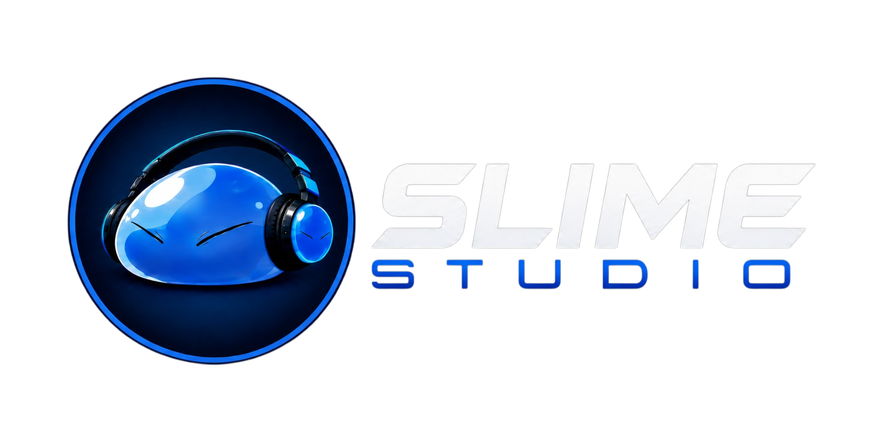
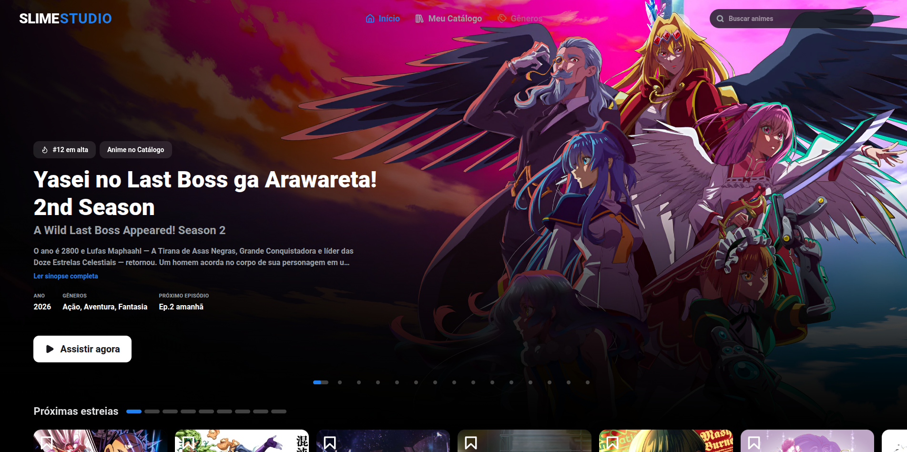
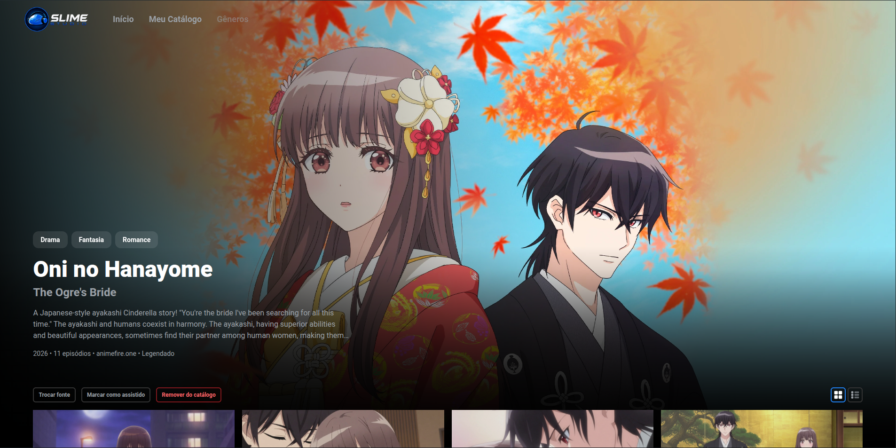
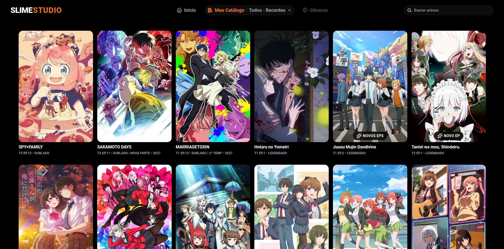
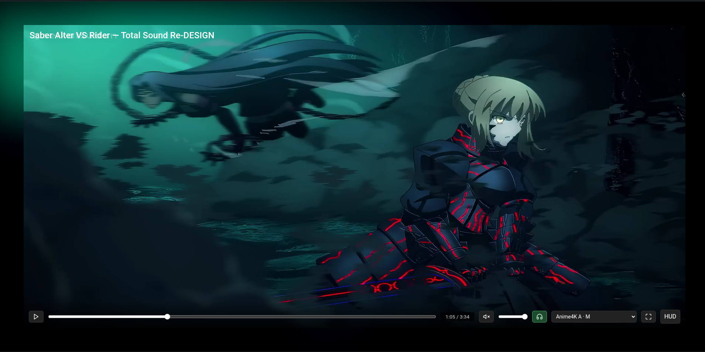
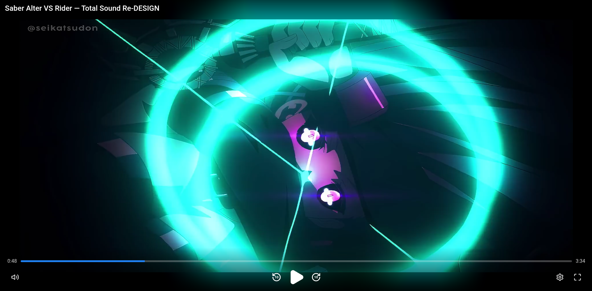
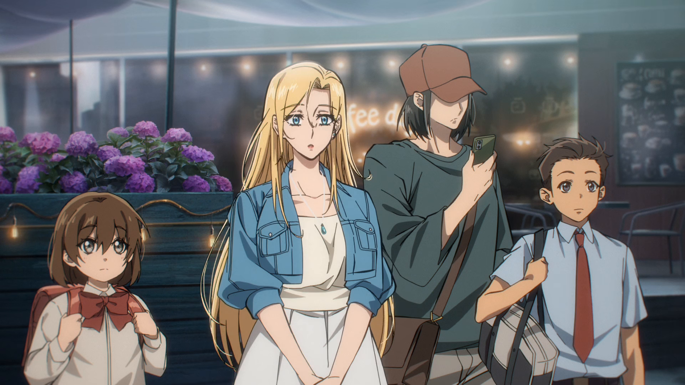
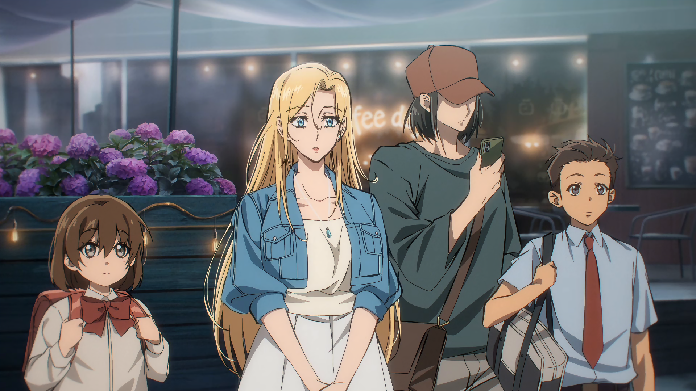
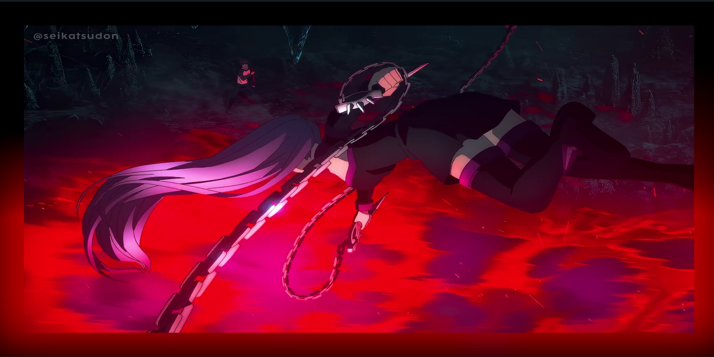
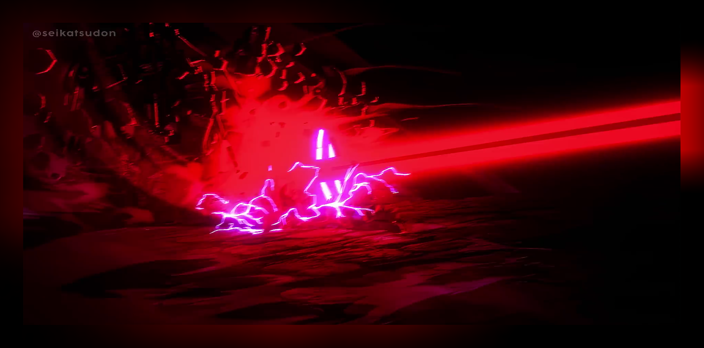

<div align="center">

<h1>
  
</h1>

Catálogo pessoal de animes com captura, empacotamento HLS e um player <br>
WebGPU com upscaling Anime4K por frame.

[Páginas](#páginas) · [Player](#player) · [Arquitetura](#arquitetura) · [Rodando localmente](#rodando-localmente)

</div>

---

Slime Studio é uma aplicação full-stack para montar e assistir um catálogo pessoal de
animes. É a evolução do [Slime Shell Web](https://github.com/rogerio-miguel/Slime_Shell_Web),
que por sua vez é a evolução do projeto original [Slime Shell](https://github.com/rogerio-miguel/Slime_Shell).

## Páginas

### Home

<div >
  
</div>

- Destaques da temporada vindos de um feed externo (AniList) — não é o catálogo local.
- Carrossel com sinopse, gêneros e próximo episódio, e fileiras horizontais: Próximas estreias, Continuar assistindo, Top 10 em alta, Novos lançamentos e fileiras temáticas.
- Escolher um item **materializa** o anime no catálogo antes de abrir a página dele.

### Página do anime

<div>
  
</div>

- Resolve a fonte de vídeo entre os sites suportados (AnimeFire, MeusAnimes e AnimesDrive, nessa ordem de prioridade).
- Lista os episódios por temporada, em grade ou lista.
- Nada é baixado até o clique em **Capturar** — a captura é sob demanda, com o status do job em tempo real (WebSocket).
- Guarda o progresso de reprodução e permite marcar episódios como assistidos.

### Catálogo

<div>
  
</div>

- Um card por franquia, com o estado de cada título (episódio atual, versão, estreia futura).
- Badge de episódios novos nos títulos já catalogados.
- Listar, abrir e remover animes do catálogo local.
- Busca por título na barra de navegação.

## Player

Os episódios capturados são empacotados em HLS e assistidos num player próprio:
`hls.js` alimenta um `<video>` oculto, e o quadro visível é um `<canvas>` WebGPU, com
barra de controles própria (sem os controles nativos do `<video>`).

<div  >
  
  <br /><br />
  
</div>

### Controles

- **Navegação:** controles por teclado e ARIA, que somem sozinhos por inatividade.
  Os botões de ±10 s também pulam 1 min 30 s se você segurar o clique por cerca de
  0,6 s.
- **Prévia de cena:** miniatura ao passar o mouse na linha do tempo, de um storyboard
  gerado pelo worker na captura.
- **Continuar assistindo:** a posição é salva durante a reprodução e restaurada ao
  reabrir o episódio. O episódio é marcado como assistido ao passar de 90%.
- **Menu de configurações:** qualidade (preset do Anime4K ou Automático), Áudio
  Cinema, estatísticas (HUD com preset, resolução e telemetria) e a lista de atalhos.

| Tecla | Ação |
|-------|------|
| `Espaço` | Reproduzir / pausar |
| `←` `→` | Retroceder / avançar 5 s |
| `↑` `↓` | Volume |
| `F` | Tela cheia |
| `M` | Mudo |
| `C` | Áudio Cinema |
| `H` | Estatísticas |
| `P` | Avançar 1 min 30 s |

As duas maiores melhorias do player foram feitas de forma independente uma da outra.

### Imagem — Upscaling Anime4K

Pipeline WebGPU que roda o [Anime4K](https://github.com/bloc97/Anime4K) frame a frame no
cliente, sobre o `<video>` oculto. O preset padrão, **A+A · VL + Deblur**, encadeia
limitação de realces, restauração por CNN, upscale 2x, uma segunda restauração e deblur.

- **Presets:** nove opções no menu de qualidade, do mais pesado ao mais leve, incluindo
  variantes com denoise (para fontes com grão), sem upscale e o modo Original (sem
  filtro). Os presets mais pesados da lib ficam de fora porque travam na GPU atual.
- **Modo Automático:** compara a taxa de apresentação do canvas com o fps do conteúdo em
  janelas de 3 s. Se a GPU não sustenta, desce um degrau; com folga por tempo suficiente,
  tenta subir; e lembra o degrau que se firmou. Falha de render ou perda do dispositivo
  de GPU também rebaixa o preset em vez de derrubar o player.
- **Troca sem piscar:** o dispositivo WebGPU e o canvas são criados uma vez por vídeo,
  então trocar de preset só remonta a cadeia de passes.
- **Preferências lembradas:** qualidade e degrau automático ficam salvos no navegador, e
  o HUD (`H`) mostra preset, resolução e telemetria em tempo real.

<div align="center">
  <b>Desligado</b><br />
  
  <br /><br />
  <b>Ligado</b><br />
  
</div>

### Som — Áudio Cinema

Grafo Web Audio próprio no `<video>`, pensado para escuta com fone. Liga e desliga no
menu de configurações (ou pela tecla `C`), sem tocar no pipeline de imagem.

- **Crossfeed:** parte do sinal cruza para o canal oposto, com o agudo atenuado e um
  atraso de cerca de 0,3 ms, para o estéreo extremo não soar "dentro de cada ouvido".
- **Dinâmica:** compressor antes do realce, para o grave amplificado não derrubar o resto,
  e limitador final contra clipping.
- **Timbre:** realce de grave com harmônicos gerados por saturação (o ouvido "reconstrói"
  o grave que o fone não entrega), corte leve de médios e ganho de presença para a voz.
- **Sem estalos:** a troca entre áudio original e processado é um crossfade de 50 ms num
  grafo fixo, sem reconectar nós durante a reprodução.
- **Resiliente:** a preferência é lembrada, e se a cadeia falhar ao montar o player segue
  com o áudio nativo e o menu marca o recurso como indisponível.

### Brilho ambiente

Halo de cor ao redor do quadro, no estilo do Ambient Mode do YouTube, desenhado num
`<canvas>` 2D atrás do vídeo e desfocado por CSS. Funciona também em tela cheia.

- **Amostra o vídeo-fonte, não o canvas WebGPU:** fica desacoplado do upscaling e não
  disputa GPU com ele.
- **Continuação das bordas:** só uma faixa fina de cada borda do vídeo alimenta o halo
  do lado correspondente, então céu claro em cima vira halo claro em cima, e chão escuro
  em baixo vira halo escuro em baixo.
- **Cor suave:** cada quadro se funde parcialmente com o anterior (média móvel), para a
  cor fluir em vez de pular nos cortes de cena.
- **Intensidade pelo movimento:** o halo acende mais em cenas de ação. O movimento é
  medido ~8 vezes por segundo num canvas fora do DOM, para a leitura de pixels não travar
  a apresentação, e o laço pausa com a aba em segundo plano.

<div>
  
  <br /><br />
  
</div>

## Arquitetura

Monorepo com dois escopos independentes, comunicando-se só por HTTP/WebSocket:

```
Slime_Studio/
├── backend/     API FastAPI + worker assíncrono + extractors + integrations
└── frontend/    React + Vite + Tailwind + player WebGPU
```

<details>
<summary><b>Backend</b> — API, worker, extractors e integrations</summary>

- **Stack:** Python, FastAPI (API), `asyncio` nativo (worker, processo separado),
  SQLAlchemy + SQLite (modo WAL), Alembic, `uv`.
- **API e worker não são acoplados diretamente** — trocam estado só via a tabela `Job`
  no SQLite (polling), sem fila externa (Celery/Redis).
- **`extractors/`** — um adapter por site de streaming (Strategy Pattern), resolve
  vídeo com cache de sessão, retry e circuit breaker (bypass anti-bot). A resolução
  de fonte tenta os sites em cadeia de fallback (AnimeFire → MeusAnimes → AnimesDrive),
  com busca por correspondência de título (`busca/`); `blogger.py` é um helper
  compartilhado para players do Blogger embutidos, e o download cai para `yt-dlp`
  quando a CDN serve manifesto DASH.
- **`integrations/`** — mesmo padrão, mas para metadados: AniList como provedor
  principal (feed da Home) e Kitsu como fallback na busca de metadados por título, com
  cache do feed (memória + espelho no SQLite, com revalidação em segundo plano).
  `tmdb.py` fornece a arte (capa, banner, thumb de episódio) quando há token do TMDB;
  sem ele, a arte cai para a AniList.
- **`worker/pipeline/`** — encapsula `ffmpeg`/`ffprobe` como subprocessos: sonda a
  mídia, decide por stream entre copiar ou recodificar, empacota em HLS e gera o
  storyboard de prévia de cena usado no player.
- **API sem autenticação, só local:** aceita apenas `Host` `localhost`/`127.0.0.1` e
  `Origin` da lista permitida (o Vite em `5173`) — pensada para uso pessoal.

```
backend/
├── api/           # rotas FastAPI, serviços, WebSocket
├── worker/        # loop assíncrono + pipeline de vídeo (ffmpeg)
├── extractors/    # adapters de site (vídeo)
├── integrations/  # adapters de metadados (AniList/Kitsu) e arte (TMDB)
├── core/          # domínio puro — enums, erros, config, texto, franquia
├── models/        # SQLAlchemy
├── db/            # engine, fila e migrations (Alembic)
└── tests/         # pytest (suíte offline por padrão)
```

</details>

<details>
<summary><b>Frontend</b> — páginas, player e cliente da API</summary>

- **Stack:** React 19, Vite, Tailwind 4, React Router, `hls.js`, `anime4k-webgpu`.
- **Rotas:** `/` (Home), `/animes` (catálogo), `/anime/:id`, `/assistir/:episodioId` e `/assistir-local/:slug` (vídeo local, sem backend).

```
frontend/src/
├── paginas/    # Inicio, Galeria, PaginaDoAnime, player (HLS e vídeo local)
├── player/     # canvas WebGPU, controles, Anime4K, Áudio Cinema, brilho ambiente
├── inicio/     # carrossel, fileiras e grades dirigidas pelo feed externo
├── api/        # cliente HTTP para o backend
├── eventos/    # eventos de jobs em tempo real (WebSocket)
└── components/ # UI compartilhada (navbar, cards, seletor de temporada, etc.)
```

</details>

<details>
<summary><b>Stack completa</b></summary>

**Backend:** FastAPI · `asyncio` · SQLAlchemy · SQLite (WAL) · Alembic · `uv` ·
BeautifulSoup4 · cloudscraper/DrissionPage (bypass anti-bot) · `yt-dlp` · Pillow ·
`ffmpeg`/`ffprobe`

**Frontend:** React 19 · Vite · Tailwind CSS 4 · React Router · `hls.js` ·
`anime4k-webgpu` · lucide-react

</details>

## Rodando localmente

Pré-requisitos: [`uv`](https://docs.astral.sh/uv/) (Python 3.12+), Node.js, `ffmpeg` e
`ffprobe` no PATH, e um navegador com suporte a WebGPU (Chrome/Brave recentes).

<details>
<summary><b>Passo a passo</b></summary>

### 1. Clonar o repositório

```bash
git clone https://github.com/rogerio-miguel/Slime_Studio.git
cd Slime_Studio
```

### 2. Instalar as dependências

```bash
cd backend && uv sync && cd ..
cd frontend && npm install && cd ..
```

### 3. Configurar o ambiente e o banco

Copie `.env.example` para `.env` na raiz do repositório. Só `DATABASE_URL` é obrigatória
(SQLite em ext4, caminho absoluto); `MEDIA_ROOT` usa `./media` por padrão e
`TMDB_READ_ACCESS_TOKEN` é opcional (sem ele a arte vem da AniList). Depois crie o schema:

```bash
cd backend && uv run alembic upgrade head
```

### 4. Subir os serviços

```bash
# backend — API
cd backend && uv run python -m api

# backend — worker (processo separado)
cd backend && uv run python -m worker

# frontend
cd frontend && npm run dev
```

Ou, para subir os três de uma vez (e abrir o Brave já apontado para o dev server):

```bash
./scripts/dev.sh
```

Depois de subir, acesse `http://localhost:5173`. A API sobe em `http://127.0.0.1:8000`.

</details>

<details>
<summary><b>Testes e lint</b></summary>

| Escopo   | Comando                               |
|----------|---------------------------------------|
| backend  | `uv run pytest` · `uv run ruff check` |
| frontend | `npm run lint` · `npm run build`      |

</details>

---

<div align="center">
  <sub>Projeto pessoal — sem afiliação com os sites de origem do conteúdo.</sub>
</div>
